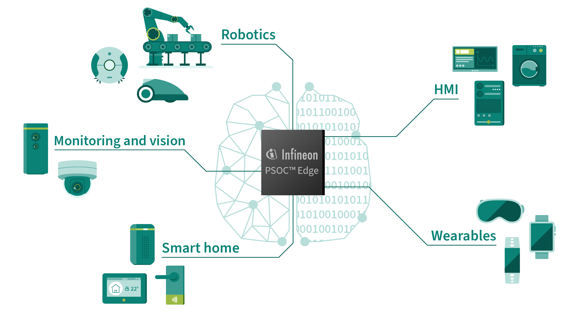

# PSOC™ Edge Training

Build your way from a first look at PSOC™ Edge to focused, hands-on development. Start with the device and development workflow, then choose the topics that match your application, including a complete path into embedded security.



## Access the training material

There are two ways to get the training material:

- **Open a single training:** Select any course link on this page to open that training on Infineon GitHub. No cloning is needed.
- **Get everything:** Clone this repository with submodules to download all courses under `courses/` at once:

  ```sh
  git clone --recurse-submodules https://github.com/luisreynosoIFX/mtb-training-psoc-edge.git
  ```

  If you already cloned it without submodules, initialize them with:

  ```sh
  git submodule update --init --recursive
  ```

## Get started

New to PSOC™ Edge? Follow these trainings in order:

1. [PSOC™ Edge introduction](https://github.com/Infineon/mtb-training-psoc-edge-e84-introduction) — Get an overview of the device, its capabilities, and its hardware-assisted machine learning, sensor-fusion, and real-time-control features.
2. [PSOC™ Edge getting started](https://github.com/Infineon/mtb-training-psoc-edge-e84-intro-ecosystem) — Set up the hardware and software tools, and find the resources you need to begin development with PSOC™ Edge E84.
3. [PSOC™ Edge technical introduction](https://github.com/Infineon/mtb-training-psoc-edge-e84-features) — Explore key device features, including audio, graphics, sensor hub, memory, low-power modes, and machine learning.

## Choose a deeper dive

### Peripherals and fundamentals

- [PSOC™ digital peripherals training](https://github.com/Infineon/mtb-training-psoc-digital-peripherals) — Build a foundation in project creation and common peripherals, including GPIO, UART, SCBs, TCPWMs, interrupts, SysTick, and WDT, across PSOC™ 4, PSOC™ 6, and PSOC™ Edge.

### Security and secure systems

Build security knowledge step by step, from core concepts to device provisioning and implementation:

- [Security introduction](https://github.com/Infineon/mtb-training-psoc-edge-security-intro) — Learn security fundamentals, IoT threats, PSOC™ Edge security features, device provisioning, Edge Protect Tools, and secure boot.
- [Designing a secure system](https://github.com/Infineon/mtb-training-psoc-edge-security-system-design) — Apply threat modeling and hardware and software protections; understand secure boot and encryption as parts of a system security strategy.
- [Extended Boot](https://github.com/Infineon/mtb-training-psoc-edge-security-extended-boot) — Follow the hardware Root of Trust boot flow and learn how Extended Boot verifies and launches boot components from RRAM.
- [Edge Protect Bootloader](https://github.com/Infineon/mtb-training-psoc-edge-security-edge-protect-bootloader) — Use the protected MCUboot-based bootloader for secure boot and authenticated firmware updates.
- [Trusted Firmware-M (TF-M)](https://github.com/Infineon/mtb-training-psoc-edge-security-tfm) — Explore boot flow, isolation, profiles, services, application integration, and configuration.
- [Encryption](https://github.com/Infineon/mtb-training-psoc-edge-security-encryption) — Compare single-key and multi-key XIP encryption and enable encryption with Edge Protect Bootloader.
- [Compare EPC2 and EPC4 security features](https://github.com/Infineon/mtb-training-psoc-edge-security-epc2-vs-epc4) — Understand how the security levels differ in isolation, services, key storage, RRAM, TF-M storage, and encryption support.
- [Security tips and tricks](https://github.com/Infineon/mtb-training-psoc-edge-security-tips-tricks) — Work through practical details such as secure CM33 peripheral access, OSPI boot, and alternate serial interfaces.

### Machine learning

- [Importing and profiling a pretrained ML model](https://github.com/Infineon/mtb-training-psoc-edge-ml-importing-profiling) — Optimize and profile neural networks for PSOC™ Edge using techniques such as pruning, sparsity, and quantization.

### Graphics and user interfaces

- [Implementing advanced graphics](https://github.com/Infineon/mtb-training-psoc-edge-graphics) — Practice graphics debugging, RLAD image compression, EEZ Studio and LVGL workflows, and GPU-based performance optimization.

### Voice and audio

- [Advanced voice and audio development](https://github.com/Infineon/mtb-training-psoc-edge-adv-voice-audio) — Configure PDM microphones, analyze clipping and dynamic range, and work with DEEPCRAFT™ Audio Enhancement and real-time audio pipelines.

### Memory and low power

- [Memory usage](https://github.com/Infineon/mtb-training-psoc-edge-memory-usage) — Learn the PSOC™ Edge memory architecture and practice memory placement, management, and retention for low-power designs.

## Training index

Browse the [ModusToolbox™ training catalog](https://github.com/luisreynosoIFX/training-modustoolbox/blob/master/README.md#psoc-edge) for PSOC™ Edge and other device training.